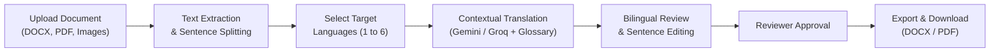

# CIPAM IPR Translator

[](https://cipam-ipr-translator.onrender.com/)
[](https://nodejs.org/)
[](https://react.dev/)
[](https://expressjs.com/)
[](https://www.postgresql.org/)
[](https://www.prisma.io/)

> **Live Application**: [https://cipam-ipr-translator.onrender.com/](https://cipam-ipr-translator.onrender.com/)

---

## 1. Overview

The **CIPAM IPR Translator** is a full-stack web application designed for the **Cell for IPR Promotion and Management (CIPAM)** to translate and localize educational, legal, and operational Intellectual Property Rights (IPR) materials from **English** into **six official Indian languages**:

- **Hindi (`hi`)**
- **Marathi (`mr`)**
- **Bengali (`bn`)**
- **Gujarati (`gu`)**
- **Tamil (`ta`)**
- **Telugu (`te`)**

The platform automates document parsing (DOCX, PDF, and image flyers via OCR), sentence-level text segmentation, domain-specific AI translation (Gemini / Groq) with glossary constraints, bilingual sentence review & human verification, and export to formatted DOCX and publication-grade PDF documents.

---

## 2. Core Workflow



1. **Document Ingestion**: Upload `.docx`, text-based `.pdf`, and `.png`/`.jpg` images (max 10 MB). Text extracted using `mammoth`, `pdf-parse`, and `tesseract.js`.
2. **Translation Pipeline**: High-accuracy translation via Google Gemini or Groq LLMs with automatic IPR glossary substitution.
3. **Bilingual Review & Editing**: Side-by-side view with three tiers per sentence:
   - `original_text`: Read-only English source.
   - `machine_text`: Read-only baseline from translation engine.
   - `final_text`: Editable translation for human review.
4. **Approval & Verification**: Sentences can be independently approved or reopened. Any new edit on an approved sentence resets approval status for re-verification.
5. **Export Engine**: Generates formatted Word documents (`.docx`) or PDFs with embedded regional Indic scripts (`Noto Sans`).
6. **IPR Glossary**: Searchable terminology dictionary. Administrators can add and delete standard terms and translations.

---

## 3. Technology Stack

| Layer | Technologies |
|:---|:---|
| **Frontend** | React 18, Vite 5, React Router DOM v6, Axios, Custom Light-Mode Design System |
| **Backend** | Node.js 20+, Express 5, Prisma ORM 7, PostgreSQL (Neon Serverless) |
| **Security** | HTTP-only JWT cookies (`SameSite=Strict`), `helmet`, `cors`, `express-rate-limit`, `bcrypt` |
| **Document Processing** | `mammoth` (DOCX), `pdf-parse` (PDF), `tesseract.js` (OCR), `docx` (Word generation), `puppeteer` (PDF generation) |
| **AI Translation** | Google Gemini API (`gemini-2.5-flash`) / Groq API (`llama-3.3-70b-versatile`) |
| **Deployment** | Docker, Render Cloud Platform |

---

## 4. API Reference

All routes are mounted under `/api/*` (and root `/*` for backward compatibility). Protected endpoints require HTTP-only JWT authentication.

### Authentication (`/api/auth`)
- `POST /api/auth/register` — Create a new user account (`name`, `email`, `password`)
- `POST /api/auth/login` — Sign in and receive secure HTTP-only session cookie
- `POST /api/auth/logout` — Clear session cookie
- `GET /api/auth/me` — Get current user profile and role

### Documents (`/api/documents`)
- `POST /api/documents` — Multipart upload (`document` file, `description`). Extracts and segments text.
- `GET /api/documents` — List uploaded documents
- `GET /api/documents/:id` — Get document details and available translations

### Translation & Review
- `POST /api/documents/:id/translate` — Initiate translation for a target language (`{ "lang": "hi" }`)
- `GET /api/documents/:id/translations?lang=hi` — Retrieve translated sentences
- `PATCH /api/translations/:id` — Update sentence:
  - Edit text: `{ "final_text": "..." }`
  - Approval: `{ "approved": true }` or `{ "approved": false }`

### Export (`/api/documents/:id/export`)
- `GET /api/documents/:id/export?lang=hi&format=docx` — Download Word document
- `GET /api/documents/:id/export?lang=ta&format=pdf` — Download PDF document

### Glossary (`/api/glossary`)
- `GET /api/glossary` — List standardized IPR terminology across all 6 languages
- `POST /api/glossary` — *(Admin Only)* Add a new term and translations
- `DELETE /api/glossary` — *(Admin Only)* Remove a glossary entry

---

## 5. Environment Configuration

### Root `.env` (Backend & Production)
```ini
PORT=5000
NODE_ENV=production

# Database (PostgreSQL / Neon)
DATABASE_URL=postgresql://<username>:<password>@<host>/<database>?sslmode=require
DIRECT_URL=postgresql://<username>:<password>@<direct_host>/<database>?sslmode=require

# Security
JWT_SECRET=<your_random_jwt_secret_32_chars_min>
FRONTEND_URL=https://cipam-ipr-translator.onrender.com

# AI Translation Engine (Provide at least one)
GEMINI_API_KEY=<your_gemini_api_key>
GROQ_API_KEY=<your_groq_api_key>
```

### `client/.env` (Frontend Local Development)
```ini
VITE_API_URL=http://localhost:5000

# Set to 'false' to communicate with live backend
# Set to 'true' to run fully offline using browser mock storage
VITE_USE_MOCK_AUTH=false
VITE_USE_MOCK_DOCUMENTS=false
VITE_USE_MOCK_TRANSLATIONS=false
VITE_USE_MOCK_EXPORTS=false
VITE_USE_MOCK_GLOSSARY=false
```

---

## 6. Quick Start & Local Setup

### 1. Clone & Install
```bash
git clone https://github.com/nsaky/cipam-ipr-translator.git
cd cipam-ipr-translator

# Install backend dependencies
npm install

# Install frontend dependencies
cd client && npm install && cd ..
```

### 2. Database Migrations & Seeds
```bash
# Apply Prisma database migrations
npx prisma migrate deploy

# Seed standardized IPR glossary terms
npm run db:seed

# (Optional) Seed default Admin account (admin@cipam.gov.in / Admin123!)
npm run db:seed-admin
```

### 3. Run Application

#### Production / Monorepo Mode (Recommended)
```bash
# Build React frontend
cd client && npm run build && cd ..

# Start Express server (serves API and client on port 5000)
npm start
```
Open [http://localhost:5000](http://localhost:5000).

#### Development Mode (Concurrent)
- **Backend API**: `npm run dev` (Runs on `http://localhost:5000`)
- **Frontend Client**: `cd client && npm run dev` (Runs on `http://localhost:5173`)

---

## 7. Development Team

| Developer | Role & Responsibilities | GitHub Profile |
|:---|:---|:---|
| **Yasir Eqbal** | Frontend Architecture, UI/UX, Review System & Client Integration | [@nsaky](https://github.com/nsaky) |
| **Injora** | Document Processing, Sentence Segmentation, Translation & Export Services | [@Injora](https://github.com/Injora) |
| **Meka Vikas** | Backend Infrastructure, Database Architecture, Security & REST APIs | [@MEKAVIKAS](https://github.com/MEKAVIKAS) |

---

## 8. License

This project is licensed under the ISC License.
