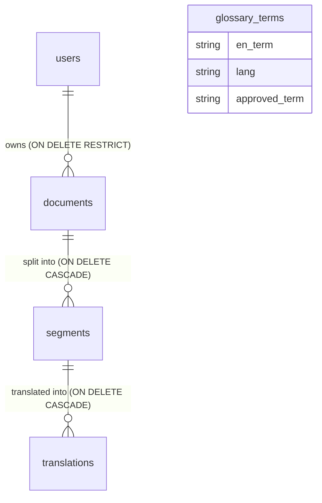

# CIPAM IPR Translator — Database Documentation

This document describes the PostgreSQL database architecture, schema definitions, constraints, indexes, relationships, seeding procedures, and operational commands for the CIPAM IPR Translator backend.

---

## 1. Database Overview

The system uses **PostgreSQL** accessed through **Prisma ORM** (v7, with the `@prisma/adapter-pg` driver adapter). A single shared Prisma Client is created in [`server/config/db.js`](../config/db.js); the schema is in [`prisma/schema.prisma`](../../prisma/schema.prisma).

All database definitions are structured into five core tables:
1. `users` — Authentication accounts and RBAC roles.
2. `documents` — Metadata and ownership for uploaded documents.
3. `segments` — Extracted ordered English sentences/paragraphs per document.
4. `translations` — Machine-generated and human-reviewed translations per segment and target language.
5. `glossary_terms` — Standardized terminology mappings for official IPR terms across the 6 supported Indian languages.

---

## 2. Table Specifications

### 2.1 Table: `users`
Stores user identities and administrative roles.
* `id` (`SERIAL`, PRIMARY KEY) — Auto-incrementing identifier.
* `name` (`VARCHAR(100)`, NOT NULL) — Full user name.
* `email` (`VARCHAR(255)`, NOT NULL, UNIQUE) — User login email address.
* `password_hash` (`TEXT`, NOT NULL) — Bcrypt password hash (10 salt rounds). Plain-text passwords are never stored.
* `role` (`VARCHAR(10)`, NOT NULL, DEFAULT `'user'`) — Restricted to `'admin'` or `'user'`.
* `created_at` (`TIMESTAMPTZ`, NOT NULL, DEFAULT `NOW()`) — Registration timestamp.

### 2.2 Table: `documents`
Tracks all uploaded files (.docx, .pdf, .png, .jpg) and associates them with an account.
* `id` (`SERIAL`, PRIMARY KEY) — Unique document identifier.
* `user_id` (`INTEGER`, NOT NULL, FOREIGN KEY → `users(id) ON DELETE RESTRICT`) — Owner of the document. `RESTRICT` prevents deleting a user account if active documents exist.
* `title` (`VARCHAR(255)`, NOT NULL) — Document display title / original filename.
* `source_type` (`VARCHAR(10)`, NOT NULL) — Restricted to `'docx'`, `'pdf'`, or `'image'`. Used by Person B's extraction routines.
* `file_path` (`VARCHAR(500)`, NOT NULL) — File storage location on disk (`server/uploads/`).
* `created_at` (`TIMESTAMPTZ`, NOT NULL, DEFAULT `NOW()`) — Upload timestamp.

### 2.3 Table: `segments`
Stores the individual English sentence segments extracted from documents.
* `id` (`SERIAL`, PRIMARY KEY) — Segment identifier.
* `document_id` (`INTEGER`, NOT NULL, FOREIGN KEY → `documents(id) ON DELETE CASCADE`) — The parent document. Deleting a document removes its segments automatically.
* `position` (`INTEGER`, NOT NULL) — 1-based sequential sentence index to preserve original ordering.
* `source_text` (`TEXT`, NOT NULL) — Original extracted English text.

### 2.4 Table: `translations`
Stores machine translations and human-reviewed versions for each segment in a target language.
* `id` (`SERIAL`, PRIMARY KEY) — Translation entry identifier.
* `segment_id` (`INTEGER`, NOT NULL, FOREIGN KEY → `segments(id) ON DELETE CASCADE`) — Referencing the segment.
* `lang` (`VARCHAR(5)`, NOT NULL) — Target language code: `'hi'`, `'mr'`, `'bn'`, `'gu'`, `'ta'`, or `'te'`.
* `machine_text` (`TEXT`, NOT NULL) — Output received from translation engine / hosted API.
* `final_text` (`TEXT`, NULLABLE) — Reviewer-edited sentence (NULL until edited).
* `approved` (`BOOLEAN`, NOT NULL, DEFAULT `FALSE`) — Reviewer approval status.

### 2.5 Table: `glossary_terms`
Standard IPR vocabulary glossary used to ensure consistency across translations.
* `id` (`SERIAL`, PRIMARY KEY) — Term identifier.
* `en_term` (`VARCHAR(255)`, NOT NULL) — English IPR term (e.g. "Patent", "Trademark").
* `lang` (`VARCHAR(5)`, NOT NULL) — Target language code: `'hi'`, `'mr'`, `'bn'`, `'gu'`, `'ta'`, or `'te'`.
* `approved_term` (`VARCHAR(255)`, NOT NULL) — Official approved translation in that target language.

---

## 3. Database Relationships



* **users → documents (1-to-Many):** One user can upload many documents. Protected by `ON DELETE RESTRICT` to prevent accidental deletion of user accounts with documents attached.
* **documents → segments (1-to-Many):** One document contains ordered sentence segments. Uses `ON DELETE CASCADE` so deleting a document cleans up all associated segments.
* **segments → translations (1-to-Many):** Each segment can have translations into up to 6 Indian languages. Uses `ON DELETE CASCADE`.
* **glossary_terms:** Independent reference table with no foreign keys, accessed by the translation service to standardize IPR terms.

---

## 4. Constraints and Indexes

| Table | Constraint / Index | Type | Purpose |
|---|---|---|---|
| `users` | `users_email_unique` | UNIQUE | Prevents duplicate accounts with the same email. |
| `users` | `users_role_check` | CHECK | Restricts `role IN ('admin', 'user')`. |
| `documents` | `documents_source_type_check` | CHECK | Restricts `source_type IN ('docx', 'pdf', 'image')`. |
| `documents` | `idx_documents_user_id` | B-TREE INDEX | Optimizes queries fetching documents by `user_id`. |
| `segments` | `idx_segments_document_id` | B-TREE INDEX | Optimizes retrieval of all segments for a document in sequence. |
| `translations` | `translations_segment_lang_unique` | UNIQUE | Prevents multiple translations of the same segment for the same language. |
| `translations` | `translations_lang_check` | CHECK | Enforces valid language codes (`hi`, `mr`, `bn`, `gu`, `ta`, `te`). |
| `translations` | `idx_translations_segment_id` | B-TREE INDEX | Speeds up joins and queries by `segment_id`. |
| `glossary_terms` | `glossary_terms_lang_en_term_unique` | UNIQUE | Ensures exactly one approved term per English term per language. |
| `glossary_terms` | `glossary_terms_lang_check` | CHECK | Enforces valid language codes (`hi`, `mr`, `bn`, `gu`, `ta`, `te`). |

---

## 5. Execution and Setup Instructions

The database is managed with **Prisma ORM** (v7). The schema is defined in
[`prisma/schema.prisma`](../../prisma/schema.prisma) and created by the SQL migrations in
`prisma/migrations/`. `DATABASE_URL` in `.env` must point at your database
(see `prisma.config.js`).

### 5.1 New database (local or hosted, e.g. Neon)
```bash
npm install            # also runs `prisma generate`
npm run db:setup       # = prisma migrate deploy (creates tables) + glossary seed
```
`db:setup` is safe to re-run: applied migrations are skipped, and the glossary seed uses
`ON CONFLICT (lang, en_term) DO NOTHING`.

### 5.2 Existing database created earlier with `schema.sql`
Your tables already exist, so tell Prisma the first migration is already applied (run once):
```bash
npx prisma migrate resolve --applied 0_init
npx prisma migrate status   # should say "Database schema is up to date!"
```
`schema.sql` and `migrations/001_add_reviewer_role.sql` are kept for reference only;
new databases should use `npm run db:setup`.

### 5.3 Changing the schema
1. Edit `prisma/schema.prisma`.
2. Run `npx prisma migrate dev --name describe_your_change` (creates a migration and regenerates the client).
3. Commit the new folder in `prisma/migrations/`.

CHECK constraints (allowed roles, languages and source types) can't be written in
`schema.prisma`; they are added by hand at the end of `prisma/migrations/0_init/migration.sql`.

### 5.4 Configuring and Seeding the Administrator Account
The administrator account is seeded using a Node.js script so the password is hashed with `bcrypt` (10 salt rounds):

1. Configure credentials in `.env`:
   ```env
   ADMIN_EMAIL=admin@cipam.gov.in
   ADMIN_NAME=CIPAM Administrator
   ADMIN_PASSWORD=your_secure_password_here
   ```
2. Execute the seed script:
   ```bash
   npm run db:seed-admin
   ```
3. Safe to re-run: if the email already exists, nothing is changed.
4. Security best practice: After seeding, remove or comment out `ADMIN_PASSWORD` from `.env`.

---

## 6. Inspecting the Database with `psql`

Useful commands for inspecting the database:

```bash
# Connect to database
psql -U mekavikas -d cipam_ipr_db

# List all tables
\dt

# Inspect specific table schema (columns, types, constraints, indexes)
\d users
\d documents
\d segments
\d translations
\d glossary_terms

# Check count of glossary terms per language
SELECT lang, COUNT(*) FROM glossary_terms GROUP BY lang ORDER BY lang;

# Verify user account role and hash format
SELECT id, name, email, role, SUBSTRING(password_hash FROM 1 FOR 10) || '...' AS hash FROM users;

# Exit psql
\q
```
